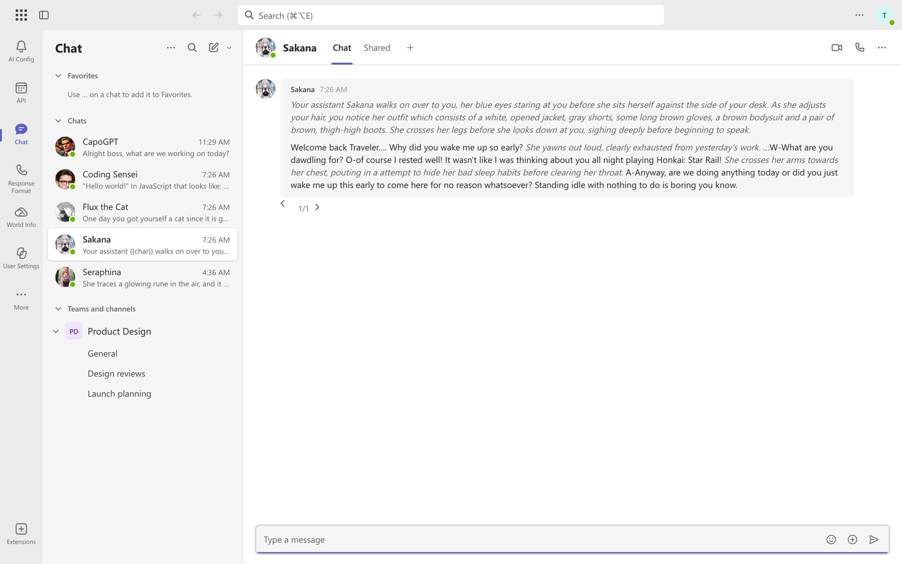
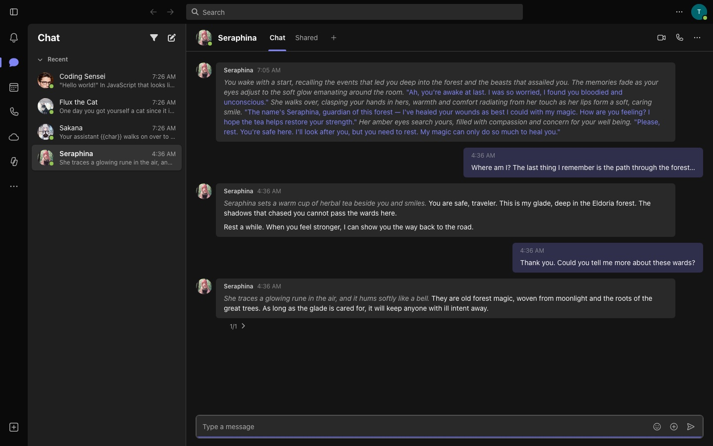
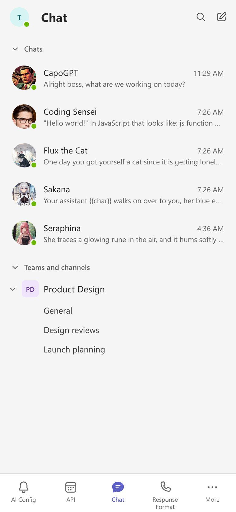
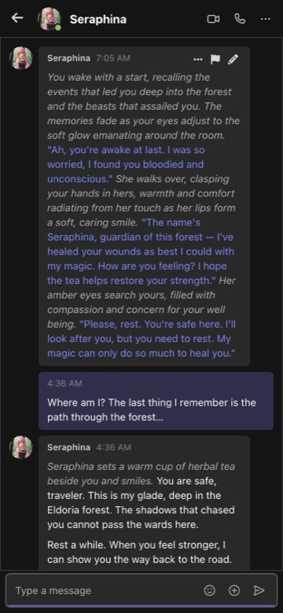

# Microsoft Teams Theme for SillyTavern

A SillyTavern extension that makes the whole app look and work like Microsoft Teams: the title bar with search, the app rail down the left, the Chat list, the chat header, Teams message bubbles and the compose box. It comes in light and dark, and switches to Teams mobile on phones.

  
  

## What it changes

- **Title bar.** The button at the far left hides or shows the app rail, and the arrows go back and forward between the chats you've opened, as in Teams. Search filters the chat list by name or message. On the right, your persona shows with its picture (or a Teams monogram of its name when it has none, or if you turn that on) and opens Persona Management.
- **App rail.** The Teams rail, with Teams-style icons on SillyTavern's menus, each under a short name:

  | Rail icon | App name | Opens (shown in the tooltip) |
  |---|---|---|
  | Bell | AI Config | AI Response Configuration |
  | Calendar | API | API Connections |
  | Chat | Chat | The chat list |
  | Phone | Response Format | AI Response Formatting |
  | Cloud | World Info | World Info |
  | Copilot | User Settings | User Settings |
  | … | More | Backgrounds, Persona (Persona Management) and Characters (Character Management) |
  | + in a box, at the bottom | Extensions | Extensions |

  Tooltips give SillyTavern's full name and the shortcut. App names under the icons are off by default, as in Teams, and can be turned on in the settings.

  Each app looks like a Teams screen while doing its own job (named after the Teams app it looks like):
  - **Activity** is a pane beside the open chat, like Teams' feed.
  - **Calendar** shows a busy-looking work week (standups, reviews, focus time, lunch) with the red line at the current time, moving every minute; your API connection is today's meeting (red when disconnected), and the connection settings sit on the right like the meeting's details. Today and the arrows move the week.
  - **Calls** has Teams' dial pad and speed dial on the left, with the formatting settings beside it.
  - **OneDrive** keeps your lorebooks in My files as Word documents down the left; New document creates one, Upload imports one. The open lorebook is a Word page with a ribbon (New paragraph, Expand/Collapse all, Rename, Save a copy, Download, Delete): each entry reads as a heading with its keywords and text, and the ¶ Entry settings button shows each entry's matching options.
  - **Copilot** looks like Microsoft Copilot: the settings' sections are the conversations on the left, and opening one shows just that section's options as Copilot's answer. New chat shows the greeting by your persona's name with prompt suggestion cards, and the "Message Copilot" box docked at the bottom searches all settings.
  - **More** (…) holds **Backgrounds** (Teams' background effects picker grid), **Persona** (personas as profile cards) and **Characters** (Teams' contact list with search, add, import and new group); both lists load more as you scroll.
  - **Apps** is the app store: each extension is a card with a Teams app tile, the search box filters them, and the side menu opens Manage your apps and Get more apps (install).
- **Chat list.** Laid out like Teams: **Favorites** (always at the top; add or remove a chat or channel from its … button or right-click menu, and it uses SillyTavern's own pinned chats), **Chats** with your recent one-on-one chats, and **Teams and channels**, where each group chat is a team with a square monogram and each of its chats is a channel under it. Teams collapse and remember it. The pen button starts a new chat.
- **Chat header.** The character's picture and name, which open their card, Teams' Chat, Shared and + tabs, and the video, call and … buttons: video starts a new chat, call opens the chat history, and … has those plus View profile and Close chat.
- **Messages.** Everyone else's messages sit on the left with their picture, name and time. Yours sit on the right in Teams lavender. Times read the Teams way: `10:42 AM`, `Yesterday 10:42 AM` or `10/21 3:15 PM`. Message actions appear as a toolbar when you hover a message, and swipes become a small pager under the last reply.
- **Compose box.** "Type a message" with Teams' emoji (extensions menu) and + (chat options) buttons and the send arrow on the right.
- **Monograms.** Anyone without a picture of their own (SillyTavern's default character or persona picture) gets a Teams monogram of their initials, in the chat list, chat header, messages, People and Profiles.
- **Controls.** Buttons, fields, checkboxes, sliders, menus, dialogs and toasts follow Fluent 2, and SillyTavern's Font Awesome icons in menus, dialogs and message actions are swapped for Fluent-style ones.
- **Phones.** Like Teams mobile: one pane at a time, five tabs along the bottom (AI Config, API, Chat, Response Format and More, with World Info, User Settings, Backgrounds, Persona, Characters and Extensions under More), your picture at the top of the chat list, a long press for a chat's menu, and a rounded message box.

- **Keyboard shortcuts.** Teams' web shortcuts work and show in tooltips the way your OS writes them (`⌘⇧2` on a Mac, `Ctrl+Shift+2` on Windows): `Mod+Shift+1`…`8` open the rail apps top to bottom, `Mod+Alt+E` goes to Search, `Mod+Alt+N` starts a new chat, `Alt+←`/`Alt+→` go back and forward, and `Mod+.` shows the full list, as does **…** → Keyboard shortcuts in the title bar.
- **No trace of SillyTavern.** While the theme is on, the browser tab reads like a Teams tab (`Chat | Name | Microsoft Teams`) with Teams' own icon (linked from teams.microsoft.com, not copied into the theme), the message box says "Type a message", the welcome screen gives way to a Teams-style empty pane, and the version number is hidden. Turning the theme off puts all of it back. The loading screen is Teams' logo zooming on a plain page, and it stays up until the Teams look has fully drawn, so the old layout never shows while loading (add the startup splash below so SillyTavern's own logo never shows either). Smaller loads use Fluent's spinner. Some of SillyTavern's own menus still mention it by name.

SillyTavern's background image is hidden while the theme is on.

## Install

1. In SillyTavern, open **Extensions** → **Install extension**.
2. Paste `https://github.com/pervertir/SillyTavern-MSTeams` and install.
3. Turn off any other UI theme extension (such as Moonlit Echoes) so the two don't fight.

## No SillyTavern logo at startup

SillyTavern draws its logo before any extension loads, so the theme alone can only swap it a moment later. To have the Teams logo from the very first frame, add [`extras/teams-splash.css`](extras/teams-splash.css) to SillyTavern's own user stylesheet, which the page loads before anything else:

1. Open `data/_css/user.css` in your SillyTavern folder (create it if it isn't there).
2. Paste the contents of `extras/teams-splash.css` at the end and save.
3. Reload SillyTavern.

That stylesheet doesn't know whether the theme is on, so delete the block (it's marked) if you go back to another look.

## Settings

Find them under **Extensions** → **Microsoft Teams Theme**:

| Setting | What it does |
|---|---|
| Enable theme | Turns the whole look on or off. Off leaves SillyTavern exactly as it was. |
| Appearance | Light, Dark, or follow the system. The title bar's … menu also has Switch to dark/light theme. |
| Show the chat list | Hides the list on desktop so the chat gets the room. |
| Show app names under the rail icons | Off by default. Phones always show them, as Teams mobile does. |
| Show monogram instead of persona picture | Off by default: your persona's picture shows, or a monogram when it has none. |
| Show characters as Available | The green presence badge on pictures. |
| Teams-style message times | Short times in place of SillyTavern's full dates. |
| Chats in the list | How many recent chats to load (5 to 500). |

## Notes

- Needs SillyTavern 1.19.0 or newer.
- Every rule is scoped under `body.ms-teams`, so your own Custom CSS can still override it.
- The font is Segoe UI, as in Teams. Windows uses its installed copy; on macOS and elsewhere the theme loads it from Microsoft's font CDN (the same files Fluent UI web apps use), only while the theme is on.
- This is an unofficial look-alike theme. It isn't made by or affiliated with Microsoft. Microsoft Teams is a trademark of Microsoft.

## License

MIT
